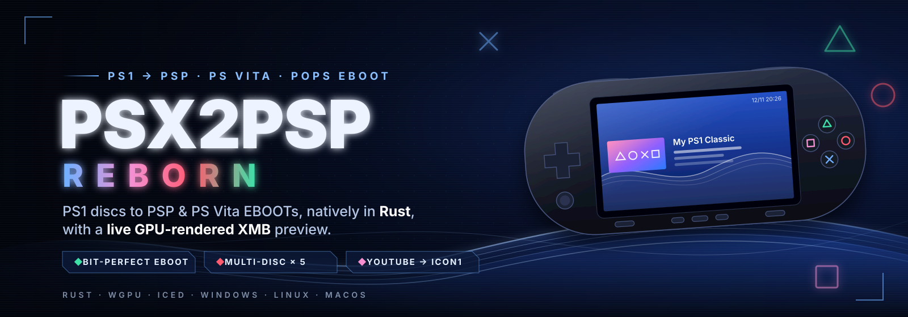
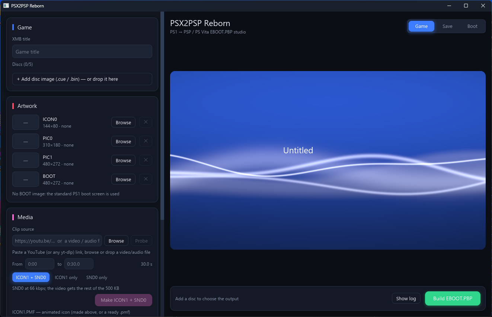
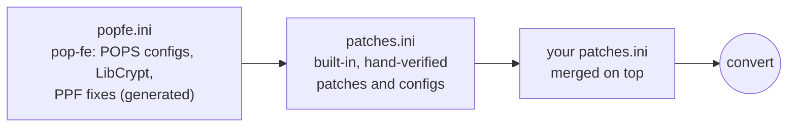
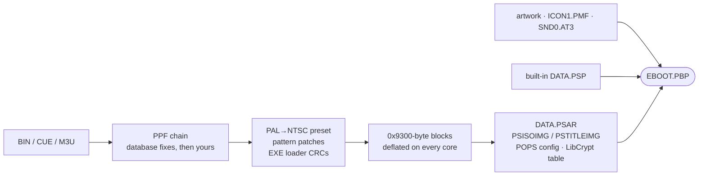

<p align="center">
  
</p>

<p align="center">
  <a href="#-quick-start"></a>
  <a href="https://www.rust-lang.org"></a>
  <a href="#-features"></a>
  <a href="#%EF%B8%8F-licence"></a>
  <br>
  <a href="../../actions/workflows/ci.yml"></a>
  <a href="../../releases/latest"></a>
  <a href="../../releases"></a>
  <a href="../../stargazers"></a>
</p>

<p align="center">
  <b>Turn your PS1 discs into POPS <code>EBOOT.PBP</code> files for the PSP and the PS Vita.</b><br>
  One native binary. Bit-perfect PBP, multi-disc up to five, a game patch database with ~2,000 titles,<br>
  an animated <code>ICON1.PMF</code> and <code>SND0.AT3</code> cut from <b>any YouTube video</b>,<br>
  and a <i>live, GPU-rendered XMB</i> that shows the result before you copy it to the memory stick.
</p>

<p align="center">
  <a href="#-quick-start">Quick start</a> ·
  <a href="#-features">Features</a> ·
  <a href="#-the-patch-database">Patch database</a> ·
  <a href="#%EF%B8%8F-command-line">Command line</a> ·
  <a href="#-faq">FAQ</a> ·
  <a href="docs/FORMAT.md">Format deep dive</a> ·
  <a href="docs/COMPARISON.md">Comparison</a>
</p>

---

<p align="center">
  
</p>

## ⚡ What is this?

**PSX2PSP-Reborn** is a from-scratch, native successor to the classic PSX2PSP v1.4.2. It builds
the same kind of PS1 Classic (POPS) `EBOOT.PBP` that Sony shipped on the PlayStation Store, from
your own BIN/CUE dumps, and it does the parts the old tools never did: it writes the animated
icon itself, fits icon and music into the XMB's budget, and knows the fixes ~2,000 games need.

- 🦀 **Written in Rust.** A GUI (`psx2psp-reborn`) and a CLI (`psx2psp`), each a single
  self-contained executable. No installer, no runtime, no .NET, no Python.
- 🎯 **Bit-perfect.** `PBP`, `PARAM.SFO`, `PSISOIMG` and `PSTITLEIMG` are written to the byte, and
  an EBOOT extracts back to the very disc image that went into it (round trips are covered by tests).
- 🌊 **What you see is what you get.** The preview is the XMB: the wave is a WGSL shader, the
  artwork is laid out like the PSP's XMB, and the icon and music play as they will on the PSP.
- 🔒 **Your discs are never touched.** Every patch is applied to the stream on its way into the
  EBOOT, never to the source files.

## 🚀 Quick start

1. **Download** the GUI for your system from the [latest release](../../releases/latest):

   | System | GUI | CLI |
   |---|---|---|
   | Windows x64 | `psx2psp-reborn-windows-x86_64.exe` | `psx2psp-windows-x86_64.exe` |
   | Linux x64 | `psx2psp-reborn-linux-x86_64` | `psx2psp-linux-x86_64` |
   | macOS Apple Silicon | `psx2psp-reborn-macos-aarch64` | `psx2psp-macos-aarch64` |

   Every release also carries `SHA256SUMS.txt`, if you want to check what you downloaded.
2. **Run it.** On Linux and macOS, `chmod +x` the file first.
3. **Drop a game in.** Drag a `.cue` (or `.bin`, `.img`, `.m3u`) onto the window. Title and
   product code are detected, and the game's fixes from the [patch database](#-the-patch-database)
   switch on by themselves.
4. **Make it yours** (optional). Drop artwork. For the animated icon and its music, pick
   **From YouTube** (paste a link) or **From my files** (your own MP4 and MP3). Flip between the
   **Game**, **Save** and **Boot** screens of the preview.
5. **Build EBOOT.PBP**, then copy its folder to `PSP/GAME/` on the memory stick.

> [!TIP]
> Files dropped on the window are routed by name: `ICON0.png`, `PIC0.png`, `PIC1.png` and
> `BOOT.png` (or `STARTDAT`) land in their slots, a `.ppf` attaches to the last disc, a `.pmf` loads
> as ICON1, an `.at3` as SND0, any other video or audio file becomes the video or music to convert,
> and an existing `EBOOT.PBP` brings in its title, ID and artwork. The
> same files can be passed on the command line: `psx2psp-reborn game.cue ICON0.png`.

> [!IMPORTANT]
> A PSP needs **custom firmware** to run a home-made POPS EBOOT. The EBOOT itself needs nothing
> else: the PS1 Classic donor files are built into the program.

## ✨ Features

### 💿 EBOOTs, to the byte

- **Single disc** (`PSISOIMG`) and **multi-disc up to five** (`PSTITLEIMG`). A `.m3u` playlist expands to its discs in order; BIN and CUE picked together
  count as one disc; CDDA audio tracks are carried in the TOC.
- **Parallel, streaming compressor.** The image is cut into `0x9300`-byte blocks and deflated on
  every core, and written as it goes: a 700 MB disc is never held in memory. Level 1 to 9
  (default 5; 9 is ~0.1% smaller and twice as slow, and the PSP reads both just as fast).
- **Extraction and inspection.** Any POPS EBOOT back to BIN/CUE, bit-exact; `psx2psp info` dumps
  its SFO, sections, discs and LibCrypt table.
- **Game database** of 10,109 serials: the XMB title is filled in from the disc's product code.
- The byte layout is documented in **[docs/FORMAT.md](docs/FORMAT.md)**.

### 🌊 A live XMB, on the GPU

- **iced 0.14 + wgpu.** The XMB wave and every layer are composed in a single WGSL full-screen
  pass, at your monitor's refresh rate.
- **Game, Save and Boot** tabs, WYSIWYG at 480×272: `PIC1` behind, `PIC0` over it, `ICON0` in its
  slot, or the boot screen POPS shows on start.
- **Animated ICON1 in the ICON0 slot, with its SND0 playing.** The preview plays the *encoded*
  ATRAC3, not the source: you hear what goes onto the PSP, and the video follows the audio clock.
- **Artwork in any format** (PNG, JPEG, BMP, GIF, WebP) is fitted to `ICON0` 144×80, `PIC0` 310×180
  and `PIC1`/boot 480×272.
- **Never blocks.** Probing, clips, downloads and builds run in background jobs with progress,
  cancel, a log panel and toasts.
- **Smooth wheel scrolling**, and a soundtrack of its own: *Firmware Glitch* loops quietly under
  the session and steps aside while your SND0 plays. One click on the note silences it; the volume
  slider next to it is remembered.

### 🎬 ICON1 and SND0 from YouTube, or from your own files

The Media card asks one question first: **From YouTube** or **From my files**.

- **From my files:** choose a video (MP4, MKV, WebM, MOV) for the animated icon and/or a song
  (MP3, WAV, FLAC, M4A, or a video's sound) for the music, set **From** and **To**, press
  **Convert**. Video and music can come from different files.
- **From YouTube:** paste a link (or any URL yt-dlp understands), set **From** and **To** in
  seconds or `m:ss`, and choose:

| Mode | You get |
|---|---|
| **ICON1 + SND0** | the animated icon and its soundtrack, from the same span |
| **ICON1 only** | the animated icon, silent |
| **SND0 only** | the soundtrack alone, detached from the video, at 66, 105 or 132 kbps |

- **Native PSMF muxer.** `ICON1.PMF` is H.264 144×80 in a PSMF container written by the program
  itself, not by a script around a Sony tool. Re-muxing Sony's own sample comes out bit-identical
  in its video, AU tables and timestamps.
- **The 500 KB budget is shared automatically.** `ICON1` and `SND0` together must fit the XMB's
  500 KB: ATRAC3 is constant-rate, so SND0 is encoded first and the video bitrate is fitted to what
  is left.
- Ready-made `.pmf` and `.at3` files are accepted as they are.

### 🩹 Fixes for ~2,000 games, built in

- **POPS configs** for about 1,800 games (1,979 product codes), imported from
  [pop-fe](https://github.com/sahlberg/pop-fe): most are the configs Sony shipped in its own PS1
  Classics. They are written into the `PSISOIMG` header, where POPS reads them.
- **LibCrypt** without cracking the disc: for 230 protected product codes the EBOOT carries the
  subchannel table that POPS answers the protection from, built from redump's own `.sbi` for 196
  of them (a `.sbi`/`.lsd` beside the disc still wins).
- **Per-dump PPF fixes**, limited by the MD5 of track 1 so they never land on the wrong dump.
- **PAL→NTSC preset**: the six generic rules of PSX2PSP v1.4.2, applied only on discs where its
  video-mode fix matches, every hit listed in the log.
- **Per-game switches**: *Game fixes*, *Unlock fps* and *60 Hz* (the game's own NTSC mode), with
  defaults that turn the last two on only for games verified on hardware.
- **CRC-aware executable patching.** Some loaders check a CRC over each executable and reset the
  console on a mismatch; when a patched executable carries such words, they are recomputed.
- **Yours to extend**: a plain INI file, merged over the built-in one. See
  [the patch database](#-the-patch-database).

### 🧰 Everything included

- **Donor built in.** The PS1 Classic `DATA.PSP` and `BASE.PBP` are compiled into the binary;
  `--donor` overrides them from the CLI if you have your own.
- **One-click tools.** The media features need ffmpeg (with libx264), yt-dlp and an ATRAC3 encoder
  (atracdenc or Sony's at3tool). **Install missing** in the GUI, or `psx2psp tools install`,
  downloads the official release binaries into `<exe folder>/tools/`, with the size shown first.
  None of them are needed to build a plain EBOOT.
- **Projects with save slots and autosave.** Everything is autosaved as you work, including the
  ICON1/SND0 you made from YouTube, and comes back on the next start, after a crash or an
  accidental close, with an **Undo** toast if you wanted a clean slate. **Save as…** keeps named
  projects (`projects/<name>/`, media included) that **Open…** brings back at any time.
- **Built-in updater.** The app checks GitHub Releases, verifies the download against
  `SHA256SUMS.txt` and swaps its own executable in place, rolling back if anything fails. Click
  the version chip to check by hand; from the CLI, `psx2psp update` (or `update --check`).

## 🩹 The patch database

What the converter knows about each game lives in INI files, layered like this (a later layer
wins):



- **Built in:** [`resources/popfe.ini`](resources/popfe.ini) (generated by
  [`tools/popfe_import.py`](tools/popfe_import.py), do not edit) under
  [`resources/patches.ini`](resources/patches.ini), whose header documents the whole format.
- **Yours:** a `patches.ini` **next to the executable** (portable install) wins; otherwise the one
  in your config folder:

  | System | User file |
  |---|---|
  | Windows | `%APPDATA%\PSX2PSP-Reborn\patches.ini` |
  | macOS | `~/Library/Application Support/PSX2PSP-Reborn/patches.ini` |
  | Linux | `$XDG_CONFIG_HOME/psx2psp-reborn/patches.ini` (`~/.config/…`) |

  A `[patch]` with the same name for the same game, or a `[game]` with the same ID, replaces the
  built-in one. A user file that does not parse is reported and ignored: the built-in database
  still applies.

A game entry and a code patch look like this:

```ini
; IDs are product codes; case and separators are ignored (SLES-02895 = SLES_028.95 = sles02895).
[game SLES-02895 SLUS-01369]
title   = Sheep, Dog 'n' Wolf / Sheep Raider
default = fix fps 60hz          ; switches that start on (default: fix)
config  = 70 00 07 06 …         ; POPS config, hex (at most 992 bytes)

[patch SLES-02895]
name    = Frame cap VSync(2) -> VSync(0)
kind    = fps                   ; fix | fps | 60hz | other (other = off until picked)
search  = ?? ?? ?? 0C 02 00 04 24 03 00 00 10 00 00 00 00 ?? ?? ?? 0C 21 20 00 00
replace = ?? ?? ?? ?? 00 ?? ?? ?? ?? ?? ?? ?? ?? ?? ?? ?? ?? ?? ?? ?? ?? ?? ?? ??
note    = Lets the game render up to 50/60 fps instead of 25/30.
```

- `search`/`replace` are equal-length hex with `??` wildcards, matched inside each sector's 2048
  data bytes (EDC/ECC are regenerated). `ppf = <hex>` embeds a whole PPF 1/2/3 instead, and
  `md5 = …` limits a patch to one dump (the track-1 MD5 that `psx2psp info disc.cue` prints).
- A patch that matches nothing, belongs to another dump, or whose PPF validation block disagrees is
  skipped and logged, never half-applied.
- `psx2psp patches disc.cue` lists everything the database has for a game, which entries are on by
  default, how many times each one hits the disc, and where your user file lives.
- The GUI shows the same thing under each disc: every patch with its hits on *that* disc (green
  `×N`, amber "no match", "fits"/"other dump" for PPFs), scanned in the background. **+** writes a
  new search/replace patch into your `patches.ini` (validated before saving), the folder button
  opens the file, reload re-reads it after a hand edit, and your own patches get a remove button
  that asks first. A game the database does not know gets a **Patch** button next to **PPF**.

## ⌨️ Command line

```text
psx2psp convert [options] <disc.cue|disc.bin>...   build an EBOOT (2-5 discs = multi-disc)
psx2psp extract <EBOOT.PBP> <out-dir>              EBOOT -> BIN/CUE, bit-exact
psx2psp info    <EBOOT.PBP | disc.cue>             SFO, sections, discs / ID, region, tracks, MD5
psx2psp patches <disc> [--id <code>] [--ppf <f>]   the patch database's entries for a game, with hits
psx2psp clip    <video|audio|URL> [clip options] [-o <dir>]   ICON1.PMF and/or SND0.AT3
psx2psp tools   [install]                          show / download ffmpeg, yt-dlp, atracdenc
```

| `convert` option | Meaning |
|---|---|
| `-o, --out <path>` | output file (default `./<DISC_ID>/EBOOT.PBP`, the layout `PSP/GAME/` expects) |
| `--title <text>`, `--id <code>` | XMB title and product code (default: detected from the disc) |
| `--icon0` / `--pic0` / `--pic1` / `--boot <image>` | artwork in any format, auto-fitted |
| `--icon1 <pmf>`, `--snd0 <audio>`, `--snd0-start <s>` | ready-made ICON1, any audio as SND0 |
| `--clip <file\|URL>` `--start` `--end` `--mode both\|icon1\|snd0` `--snd0-kbps 66\|105\|132` | cut ICON1 + SND0 from a video |
| `--ppf <file>`, `--ppf2` … `--ppf5` | your own PPF, for disc 1 or disc N |
| `--pal-ntsc` | the generic PAL→NTSC preset, where it matches |
| `--fps-unlock` / `--no-fps-unlock`, `--60hz` / `--50hz` | the game's fps and 60 Hz switches |
| `--no-title-fixes` | skip the game's fixes and POPS config |
| `--patch <name>`, `--no-patch <name>` | turn one database entry on or off |
| `--level <1-9>` | deflate level (default 5) |
| `--donor <pbp>` | your own PS1 Classic donor instead of the built-in one |

```bash
# Two discs, cover art, and an icon + music cut from 1:05 to 1:35 of a YouTube video
psx2psp convert --icon0 cover.jpg --pic1 bg.png \
  --clip "https://youtu.be/<id>" --start 1:05 --end 1:35 "Disc 1.cue" "Disc 2.cue"

# Just the animated icon, from a local video
psx2psp clip intro.mp4 --start 0:05 --end 0:25 --mode icon1 -o out
```

## 🧠 How it works



```text
crates/
  psx2psp-core      PBP · SFO · CUE/BIN · PSISOIMG/PSTITLEIMG writer and reader · TOC
  psx2psp-patching  sector model · EDC/ECC · PPF 1/2/3 · pattern patches · EXE loader CRCs
  psx2psp-media     artwork fitting · PSMF (ICON1) muxer and parser · clip pipeline ·
                    ffmpeg / yt-dlp / atracdenc / at3tool adapters · tool provisioning
  psx2psp-engine    use cases (convert / extract / inspect / probe) · patch DB · the `psx2psp` CLI
  psx2psp-app       the iced GUI `psx2psp-reborn` · XMB WGSL shader · preview audio
```

## 🛠️ Build from source

You need Rust 1.88 or newer (edition 2024). On Linux, also the ALSA headers
(`sudo apt install libasound2-dev pkg-config`).

```bash
cargo build --release
```

The binaries are `target/release/psx2psp-reborn` (GUI) and `target/release/psx2psp` (CLI).
Set `PSX2PSP_FPS=1` to have the GUI print its frame rate and worst frame time every 2 s.

## 🧪 Tests

```bash
cargo test --workspace
```

The suite covers bit-exact round trips of single and multi-disc EBOOTs, the PSMF muxer against
Sony's ICON1 layout, PPF, patterns, EDC/ECC, loader CRCs, the patch database and LibCrypt. Tests
that need a Sony sample or an external tool skip themselves when it is missing. The GUI test
`xmb::tests::screens_composite_layers_correctly` renders the three preview screens off-screen on
the real GPU, and skips itself on a machine without a GPU adapter.

Dependencies are checked with [cargo-deny](https://github.com/EmbarkStudios/cargo-deny) against
[`deny.toml`](deny.toml) (licences, sources, RustSec advisories; CI runs it on every push):

```bash
cargo deny check
```

## 📊 How it compares

| | **Reborn** | PSXPackager | PSX2PSP-Enhanced | pop-fe |
|---|:---:|:---:|:---:|:---:|
| Native single binary | ✓ | .NET | Python + DLL | Python |
| Animated XMB preview, Game / Save / Boot | ✓ | wave only | ✗ | ✗ |
| ICON1.PMF generated | ✓ | ✗ | GIF only | ✗ |
| One clip → ICON1 + SND0, budget fitted | ✓ | ✗ | ✗ | ✗ |
| POPS configs · LibCrypt | ✓ · ✓ | ? · ✗ | ? · ✗ | ✓ · ✓ |
| CHD / archive input | ✗ | ✓ | ✗ | CHD |

The full matrix, with sources and the gaps still open: **[docs/COMPARISON.md](docs/COMPARISON.md)**.

## ❓ FAQ

<details>
<summary><b>Has it been tested on real hardware?</b></summary>

Yes, on a real PSP: a PAL game built with its config, physics fix, frame-cap unlock and 60 Hz
patches boots, loads and plays. The layouts are also validated against Sony's own EBOOTs and
samples. Not yet confirmed on hardware: a PS Vita, disc swapping in a multi-disc EBOOT, a
LibCrypt title, and the generated ICON1/SND0 on the XMB. Reports are very welcome.
</details>

<details>
<summary><b>Where does the EBOOT go?</b></summary>

`ms0:/PSP/GAME/<FOLDER>/EBOOT.PBP`. The default output, `./<DISC_ID>/EBOOT.PBP`, is already that
folder: copy it under `PSP/GAME/`.
</details>

<details>
<summary><b>The game runs slowly, or the picture is off. What can I try?</b></summary>

Look at the disc's patch list (GUI, or `psx2psp patches disc.cue`). *Game fixes* is on by default
and is the safe choice. *Unlock fps* and *60 Hz* make the emulated CPU work harder and are on by
default only for games verified on hardware. For a PAL game, prefer the game's own *60 Hz* switch
over the generic PAL→NTSC preset when it has one. Found a fix that works? Put it in your
`patches.ini` and open an issue or a pull request.
</details>

<details>
<summary><b>Do I need ffmpeg, yt-dlp or atracdenc?</b></summary>

Only for clips and SND0. Plain EBOOTs, artwork, patches and the preview need nothing. The tools
are looked up next to the executable, in `<exe>/tools/` and on `PATH`. **Install missing** fetches
all three on Windows, ffmpeg and yt-dlp on Linux, and yt-dlp on macOS. Elsewhere: `brew install
ffmpeg` on macOS, and atracdenc built from [its source](https://github.com/dcherednik/atracdenc)
on Linux and macOS (or Sony's at3tool, if you have it).
</details>

<details>
<summary><b>Why is my clip shorter or softer than I asked?</b></summary>

`ICON1.PMF` and `SND0.AT3` together must stay within the XMB's 500 KB. SND0 is
encoded first, then the video bitrate is fitted to what is left. A shorter span, or *ICON1 only*,
leaves more room for the picture.
</details>

<details>
<summary><b>Windows or macOS refuses to start the download.</b></summary>

The binaries are not code-signed. On Windows choose *More info → Run anyway*; on macOS run
`xattr -d com.apple.quarantine psx2psp-reborn-macos-aarch64` once. `SHA256SUMS.txt` in the release
lets you check the file first.
</details>

## 🔧 Troubleshooting

| Issue | Fix |
|---|---|
| *cannot detect game ID; pass --id* | the product code could not be read from the disc: pass `--id SLUS00594` (or type the ID in the GUI) |
| *your patches.ini is ignored* | the user file has a syntax error, named in the message; the built-in database still applies |
| A patch says it was skipped | it is for another build or dump of the game: `psx2psp info disc.cue` prints your track-1 MD5 |
| Clip fails right away | a tool is missing: `psx2psp tools`, or **Install missing** in the GUI |
| No preview on an old GPU | the GUI needs a GPU that wgpu can drive; the CLI needs no GPU at all |

## 🙏 Credits

- **[pop-fe](https://github.com/sahlberg/pop-fe)** by sahlberg and contributors (LGPL-2.1):
  the POPS configs, LibCrypt magic words and PPF fixes in `resources/popfe.ini`, with the community
  work it credits (among others The_Ho's POPS config research and krHACKen's LibCrypt patches).
- **[redump.org](http://redump.org)** and **[psxdatacenter.com](https://psxdatacenter.com/sbifiles.html)**:
  the LibCrypt `.sbi` files in `resources/libcrypt_sbi.tsv.z`, dumped by redump and collected by
  psxdatacenter.
- **PSX2PSP v1.4.2** and the **Popstation GUI GameID Database** (SeattleMan): the generic PAL→NTSC
  rules and the 10,109-serial title database.
- **popstation / popstationr**, **[PSXPackager](https://github.com/RupertAvery/PSXPackager)** and
  pop-fe again, against which every byte of the format was cross-checked.
- **[atracdenc](https://github.com/dcherednik/atracdenc)**, **[FFmpeg](https://ffmpeg.org)** with
  x264, and **[yt-dlp](https://github.com/yt-dlp/yt-dlp)**: downloaded on request from their
  official releases, never bundled.
- **[iced](https://github.com/iced-rs/iced)** and **[wgpu](https://github.com/gfx-rs/wgpu)**, which
  draw every pixel of the GUI.

## ⚖️ Licence

The source code is dual-licensed under **[MIT](LICENSE-MIT)** or **[Apache-2.0](LICENSE-APACHE)**,
at your option. The binaries also contain third-party Rust crates (MIT, Apache-2.0, BSD, ISC,
Zlib, MPL-2.0 for the MP3 decoder…) and the Inter font (OFL-1.1): their notices are in
[`THIRD-PARTY-LICENSES.md`](THIRD-PARTY-LICENSES.md), also attached to every release. Regenerate it
with `cargo about generate --workspace --frozen about.hbs -o THIRD-PARTY-LICENSES.md`.
Some files in `resources/` are not covered by the code licence:

- `resources/popfe.ini` is generated from pop-fe and keeps **pop-fe's LGPL-2.1** licence.
- `resources/BASE.PBP` and `resources/DATA.PSP` are the PS1 Classic donor (from Sony's
  *Hot Shots Golf 2* EBOOT), the same files other POPS tools ship; they are © Sony Interactive
  Entertainment.

PlayStation, PSP, PS Vita and POPS are trademarks of Sony Interactive Entertainment. This project
is **not affiliated with or endorsed by Sony**, and it ships no games: convert only discs you own.
